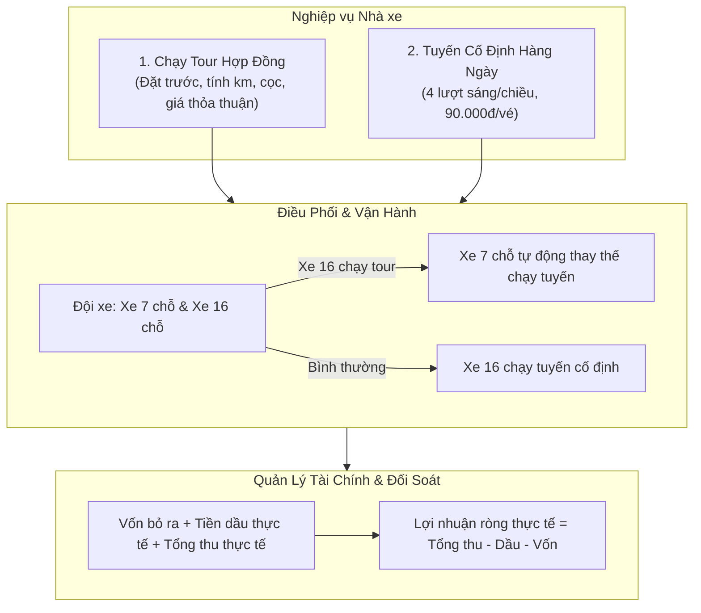
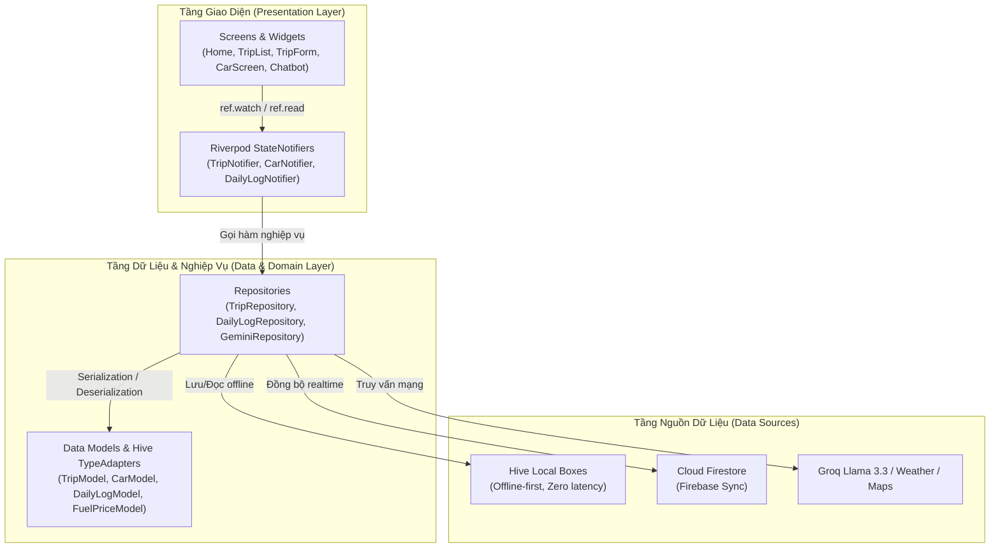
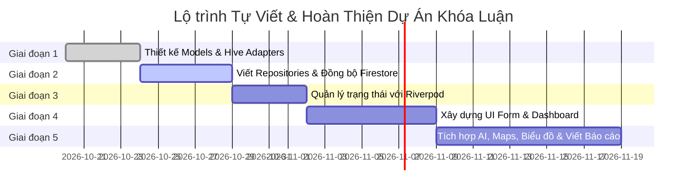

# KẾ HOẠCH TỔNG THỂ DỰ ÁN KHÓA LUẬN TỐT NGHIỆP
## Đề tài: Xây dựng Ứng dụng Di động Quản lý Đặt xe Du lịch và Điều phối Vận tải Hành khách Tích hợp Trợ lý AI

---

## 1. THÔNG TIN TỔNG QUAN ĐỀ TÀI

* **Tên đề tài học thuật:** *Xây dựng ứng dụng di động quản lý đặt xe du lịch và điều phối vận tải hành khách tích hợp trợ lý ảo AI*
* **Tên ứng dụng (Sản phẩm mẫu):** Du Lịch Năm Ái
* **Lĩnh vực:** Phát triển phần mềm di động (Mobile Application Development), Hệ thống thông tin quản lý (MIS).
* **Nền tảng công nghệ chính:**
  * **Frontend / Framework:** Flutter (Dart), hỗ trợ chạy trên Android Phone & Android Tablet.
  * **State Management:** Riverpod (`StateNotifierProvider`).
  * **Local Storage (Offline-first):** Hive (NoSQL Key-Value, High Performance).
  * **Cloud Backend & Database:** Firebase Authentication, Cloud Firestore.
  * **Trí tuệ nhân tạo (AI):** Groq Cloud API (Llama 3.3 70B Versatile) + Heuristic Fallback Engine offline.
  * **Third-party APIs:** OpenWeatherMap API, Google Maps URL Scheme, Flutter Local Notifications.

### 1.1. Tính cấp thiết & Lý do chọn đề tài
* Các hộ kinh doanh xe dịch vụ du lịch quy mô nhỏ (từ 1–5 xe) tại Việt Nam phần lớn vẫn ghi chép sổ sách hoặc dùng ghi chú rời rạc trên điện thoại, dẫn đến:
  * Khó theo dõi tiền cọc, số tiền còn lại khách phải thanh toán.
  * Dự toán chi phí chuyến đi không chính xác do giá xăng dầu biến động thường xuyên, quên tính phí cầu đường hoặc hao mòn.
  * Xung đột lịch xe khi vừa chạy tour đường dài, vừa chạy tuyến cố định đưa đón hành khách hàng ngày.
  * Thiếu công cụ đối soát doanh thu, chi phí dầu, vốn và lợi nhuận ròng hàng ngày/tháng.
* Đề tài giải quyết bài toán thực tế này bằng một ứng dụng di động **Offline-First**, hoạt động mượt mà ngay cả khi xe đi vào vùng sóng yếu, tích hợp công thức dự toán chi phí tự động và trợ lý ảo thông minh.

---

## 2. PHÂN TÍCH YÊU CẦU NGHIỆP VỤ (BUSINESS LOGIC)

### 2.1. Nghiệp vụ Chạy Tour Hợp đồng (Theo chuyến)
* **Thông tin chuyến:** Khách hàng, số điện thoại, điểm đón, điểm đến, ngày giờ đi, loại xe (7 chỗ / 16 chỗ).
* **Công thức dự toán chi phí tự động (Reactive Cost Estimation):**
  $$\text{Chi phí nhiên liệu} = \frac{\text{Số km dự kiến} \times \text{Định mức tiêu hao (L/100km)}}{100} \times \text{Đơn giá nhiên liệu}$$
  $$\text{Giá đề xuất} = \text{Chi phí nhiên liệu} + \text{Phí cầu đường} + \text{Công tài xế} + \text{Phí khác} + \text{Lợi nhuận kỳ vọng}$$
  $$\text{Số tiền còn lại} = \text{Giá chốt với khách} - \text{Tiền cọc}$$
* **Ràng buộc nghiệp vụ (Business Constraints):**
  * Giá chốt với khách hàng sau khi đã chuyển sang trạng thái `Đã xác nhận (confirmed)`, `Đang chạy (running)` hoặc `Hoàn thành (completed)` sẽ được khóa cố định, không tự động biến động khi giá xăng dầu thay đổi.
* **Vòng đời trạng thái chuyến đi:**
  `Chờ xác nhận (pending)` $\rightarrow$ `Đã xác nhận (confirmed)` $\rightarrow$ `Đang chạy (running)` $\rightarrow$ `Hoàn thành (completed)` (hoặc `Đã hủy (cancelled)`).

### 2.2. Nghiệp vụ Chạy tuyến cố định (Daily Fixed Route)
* Xe 16 chỗ chạy tuyến hàng ngày với **4 lượt chạy**:
  1. Buổi sáng - Lượt vào
  2. Buổi sáng - Lượt ra
  3. Buổi chiều - Lượt vào
  4. Buổi chiều - Lượt ra
* **Đơn giá vé cố định:** $90.000\text{ đ}/\text{khách}$.
* **Cơ chế thay thế tự động (Vehicle Substitution):**
  * Khi xe 16 chỗ được xếp lịch chạy tour hợp đồng trong ngày, hệ thống tự động gắn nhãn: *"Xe 7 chỗ chạy thay thế tuyến hàng ngày"* để đảm bảo không bị gián đoạn tuyến xe thường nhật.

### 2.3. Nghiệp vụ Đối soát tài chính (Reconciliation & Net Profit)
* Cuối mỗi ngày, chủ xe nhập:
  * **Mức vốn bỏ ra ban đầu:** Chi tiêu tiền mặt cầm theo xe.
  * **Tiền dầu đổ thực tế:** Hóa đơn/tiền dầu thực trả trong ngày.
  * **Tổng thu thực tế:** Tổng số tiền mặt nhận về sau ngày chạy.
* **Công thức tính lợi nhuận thực tế:**
  $$\text{Lợi nhuận thực tế ngày} = \text{Tổng thu thực tế} - \text{Tiền dầu thực tế} - \text{Vốn bỏ ra}$$
  $$\text{Lợi nhuận thực tế tháng} = \sum \text{Tổng thu} - \sum \text{Tiền dầu} - \sum \text{Vốn}$$

---

## 3. KIẾN TRÚC HỆ THỐNG & DỮ LIỆU (SYSTEM ARCHITECTURE)

### 3.1. Mô hình Kiến trúc Clean Architecture (Tầng hóa)

### 3.2. Thiết kế Cơ sở dữ liệu (Data Schemas)

#### Bảng 1: `TripModel` (Hive TypeID: 6 | Collection: `trips`)
| Trường dữ liệu | Kiểu dữ liệu | Ý nghĩa |
|---|---|---|
| `id` | `String` | Khóa chính (UUID v4) |
| `customerName` | `String` | Tên khách hàng |
| `customerPhone` | `String` | Số điện thoại liên hệ |
| `carId` | `String` | ID xe được phân công |
| `carType` | `String` | `7_seater` hoặc `16_seater` |
| `fuelType` | `String` | `ron95`, `e5_ron92`, `diesel` |
| `startTime` | `DateTime` | Ngày giờ khởi hành |
| `pickupLocation` | `String` | Địa chỉ điểm đón |
| `destination` | `String` | Địa chỉ điểm đến |
| `estimatedKm` | `double` | Số kilomet dự kiến |
| `fuelConsumptionPer100Km` | `double` | Định mức lít/100km |
| `fuelPrice` | `double` | Giá nhiên liệu tại thời điểm lập chuyến |
| `fuelCost` | `double` | Chi phí xăng/dầu ước tính |
| `tollFee`, `driverFee`, `otherFee` | `double` | Phí cầu đường, công tài xế, phí phát sinh |
| `expectedProfit` | `double` | Lợi nhuận kỳ vọng |
| `suggestedPrice` | `double` | Giá đề xuất của hệ thống |
| `finalPrice` | `double` | Giá chốt với khách hàng |
| `deposit` | `double` | Tiền cọc |
| `remainingAmount` | `double` | Tiền còn lại phải thu |
| `status` | `String` | `pending`, `confirmed`, `running`, `completed`, `cancelled` |
| `note` | `String?` | Ghi chú chuyến đi |
| `syncStatus` | `String` | Trạng thái đồng bộ (`synced`, `syncing`, `failed`) |

#### Bảng 2: `CarModel` (Hive TypeID: 4 | Collection: `cars`)
| Trường dữ liệu | Kiểu dữ liệu | Ý nghĩa |
|---|---|---|
| `id` | `String` | `car_7` hoặc `car_16` |
| `name` | `String` | Tên xe (VD: Toyota Innova, Ford Transit) |
| `plateNumber` | `String` | Biển số xe |
| `carType` | `String` | `7_seater` hoặc `16_seater` |
| `fuelType` | `String` | Loại nhiên liệu tiêu chuẩn |
| `fuelConsumptionPer100Km` | `double` | Định mức tiêu hao mặc định |
| `status` | `String` | `idle` (rảnh), `busy` (bận), `maintenance` (bảo dưỡng) |

#### Bảng 3: `DailyLogModel` (Hive TypeID: 7 | Collection: `daily_logs`)
| Trường dữ liệu | Kiểu dữ liệu | Ý nghĩa |
|---|---|---|
| `id` | `String` | Ngày ghi nhận (Format: `YYYY-MM-DD`) |
| `date` | `DateTime` | Thời gian cụ thể |
| `passengerCountMorningIn` | `int` | Số khách lượt Sáng Vào |
| `passengerCountMorningOut` | `int` | Số khách lượt Sáng Ra |
| `passengerCountAfternoonIn`| `int` | Số khách lượt Chiều Vào |
| `passengerCountAfternoonOut`| `int` | Số khách lượt Chiều Ra |
| `capital` | `double` | Mức vốn tiền mặt đem theo trong ngày |
| `actualFuelCost` | `double` | Tiền dầu đổ thực tế trong ngày |
| `actualRevenue` | `double` | Tổng tiền thu thực tế nhận về sau ngày chạy |
| `syncStatus` | `String` | `synced` / `syncing` / `failed` |

#### Bảng 4: `FuelPriceModel` (Hive TypeID: 5 | Box: `fuel_prices`)
| Trường dữ liệu | Kiểu dữ liệu | Ý nghĩa |
|---|---|---|
| `ron95` | `double` | Đơn giá xăng RON 95 (đ/lít) |
| `e5Ron92` | `double` | Đơn giá xăng E5 RON 92 (đ/lít) |
| `diesel` | `double` | Đơn giá dầu Diesel (đ/lít) |
| `updatedAt` | `DateTime` | Ngày giờ cập nhật giá |

---

## 4. KẾ HOẠCH TRIỂN KHAI CHI TIẾT (5 GIAI ĐOẠN)

### Giai đoạn 1: Thiết kế Tầng Dữ Liệu & Local Database (4 ngày)
* **Nhiệm vụ:**
  1. Tạo thư mục chuẩn: `lib/data/models/`.
  2. Tự tay viết các class Model: `CarModel`, `TripModel`, `DailyLogModel`, `FuelPriceModel`.
  3. Viết các phương thức bắt buộc: `toMap()`, `fromMap()`, `copyWith()`.
  4. Tạo các `TypeAdapter` kế thừa `TypeAdapter<T>` của Hive và đăng ký trong `HiveService`.
* **Kỹ năng nắm được:** Quá trình tuần tự hóa (Serialization), Binary Reader/Writer trong Hive.

### Giai đoạn 2: Tầng Lưu Trữ & Cơ chế Offline-First (5 ngày)
* **Nhiệm vụ:**
  1. Viết `TripRepository` và `DailyLogRepository` cho Hive.
  2. Viết Cloud Repository tương ứng cho Cloud Firestore.
  3. Cài đặt thuật toán đồng bộ 2 chiều:
     * App khởi động: nạp từ Hive box ra bộ nhớ (hiển thị < 0.1s).
     * Khi có thay đổi: ghi vào Hive trước, sau đó phát background task ghi lên Firestore.
     * Khi mất mạng: bắt `catch (e)` và đánh dấu `syncStatus = 'failed'`.
* **Kỹ năng nắm được:** Xử lý bất đồng bộ (`async/await`), kỹ thuật xử lý dữ liệu ngoại tuyến (Offline-First Design Pattern).

### Giai đoạn 3: Tầng Quản lý Trạng thái với Riverpod (4 ngày)
* **Nhiệm vụ:**
  1. Tạo `trip_provider.dart`, `daily_log_provider.dart`, `car_provider.dart`.
  2. Triển khai các class kế thừa `StateNotifier<List<T>>`.
  3. Viết các hàm: `addTrip()`, `updateTrip()`, `deleteTrip()`, `saveDailyLog()`.
  4. Đăng ký các provider toàn cục trong `app_providers.dart`.
* **Kỹ năng nắm được:** Quản lý vòng đời trạng thái (State Lifecycle), nguyên lý bất biến (Immutability), luồng một chiều (Unidirectional Data Flow).

### Giai đoạn 4: Thiết kế Giao diện Người dùng - UI/UX (7 ngày)
* **Nhiệm vụ:**
  1. **Màn hình Trang chủ (`HomeScreen`):**
     * Banner lời chào + Doanh thu tổng hợp.
     * Thẻ trạng thái 2 xe (Xe 7 chỗ & Xe 16 chỗ).
     * Thẻ chuyến đi sắp tới.
     * Thẻ thời tiết địa phương.
     * Bảng điều khiển tuyến cố định 16 chỗ + Đối soát doanh thu ngày/tháng (Lưới 2x2, nút bấm to phù hợp tablet, cơ chế chạm ra ngoài tự ẩn bàn phím).
  2. **Màn hình Lịch xe (`TripListScreen`):**
     * Bộ lọc TabBar / Chip: Tất cả, 7 chỗ, 16 chỗ, Trạng thái.
     * Danh sách chuyến hiển thị rõ ràng: giờ đón, tên khách, cọc, giá chốt, trạng thái.
  3. **Màn hình Form Đặt Tour (`TripFormScreen`):**
     * Form động: Khi nhập số km hoặc chọn loại xe $\rightarrow$ hệ thống tự động nhảy giá đề xuất và số tiền còn lại.
  4. **Màn hình Chi tiết Chuyến (`TripDetailScreen`):**
     * Nút gọi trực tiếp khách hàng (`url_launcher`).
     * Nút mở Google Maps dẫn đường tới điểm đón và điểm đến.

### Giai đoạn 5: Tích hợp AI, Biểu đồ & Viết Báo cáo Khóa luận (10 ngày)
* **Nhiệm vụ:**
  1. **Tích hợp Trợ lý AI Chatbot:**
     * Gọi Groq API (Llama 3.3) qua HTTP post với system prompt chuẩn bị sẵn ngữ cảnh dữ liệu xe, lịch trình và doanh thu.
     * Cơ chế Fallback heuristic offline: Trả lời tự động các câu hỏi về xe rảnh/bận, giá xăng dầu khi mất mạng.
     * Widget Chathead bóng nổi kéo thả (`Draggable Snapping Chathead`).
  2. **Biểu đồ Thống kê (`fl_chart`):**
     * Biểu đồ doanh thu theo tuần/tháng.
  3. **Viết Báo cáo Khóa luận:**
     * Viết tài liệu word theo chuẩn format trường (Mở đầu, Cơ sở lý thuyết, Phân tích thiết kế, Cài đặt thử nghiệm, Kết luận).

---

## 5. BỘ CÂU HỎI PHẢN BIỆN THƯỜNG GẶP CỦA HỘI ĐỒNG & CÁCH TRẢ LỜI

| STT | Câu hỏi của Thầy/Cô Hội đồng | Hướng trả lời chuẩn kỹ thuật |
|---|---|---|
| **1** | *Tại sao em chọn Flutter và Riverpod mà không dùng React Native hoặc Provider thông thường?* | **Trả lời:** Flutter biên dịch trực tiếp ra native code (AOT compilation) cho hiệu năng 60–120 FPS mượt mà. Riverpod là phiên bản cải tiến của Provider giúp phát hiện lỗi thiếu Provider ngay tại Compile-time thay vì Runtime, không phụ thuộc vào `BuildContext`, dễ viết Unit Test và quản lý state an toàn. |
| **2** | *Giải thích cơ chế Offline-first trong app của em hoạt động như thế nào?* | **Trả lời:** Ứng dụng ưu tiên lưu trữ cục bộ vào cơ sở dữ liệu NoSQL Hive trước để người dùng thao tác tức thì không có độ trễ mạng. Mỗi bản ghi có cờ `syncStatus`. Khi có kết nối Internet, Service sẽ đồng bộ nền lên Cloud Firestore. Nếu mất mạng, dữ liệu vẫn được bảo toàn và chuyển cờ `failed` để thử lại khi online. |
| **3** | *Tại sao khi sửa giá xăng dầu, các chuyến xe đã hoàn thành không bị nhảy lại giá?* | **Trả lời:** Đây là ràng buộc logic nghiệp vụ (Business Rule). Trong model `TripModel`, giá nhiên liệu và giá chốt được lưu cố định tại thời điểm lập hợp đồng. Hàm tính giá tự động chỉ áp dụng khi chuyến ở trạng thái `pending`. Các trạng thái `confirmed`, `running`, `completed` đều được khóa giá chốt để bảo toàn hợp đồng tài chính đã thỏa thuận với khách. |
| **4** | *Nếu hai thiết bị cùng sửa một chuyến xe khi mất mạng thì khi có mạng xử lý xung đột ra sao?* | **Trả lời:** Trong phạm vi nhà xe nhỏ với 1–2 tài xế, ứng dụng áp dụng chiến lược *Last-Write-Wins* dựa trên trường `updatedAt` của bản ghi, hoặc ưu tiên trạng thái có mức độ hoàn thành cao hơn (`completed` ưu tiên hơn `confirmed`). |
| **5** | *Trợ lý AI trong app có vai trò gì ngoài việc trò chuyện?* | **Trả lời:** AI hoạt động như một nhân viên điều phối thông minh. Nó được cung cấp toàn bộ Context của nhà xe (danh sách chuyến, lịch trống của xe 7 chỗ và 16 chỗ, bảng giá xăng dầu, thời tiết). Khi chủ xe hỏi *"Ngày mai xe 16 chỗ có rảnh không?"* hoặc *"Tính giúp anh chi phí đi Vũng Tàu"*, AI sẽ tính toán và đưa ra câu trả lời chính xác dựa trên dữ liệu thật của nhà xe. |
